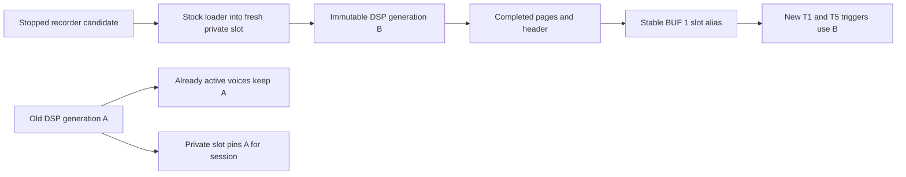

# Flex buffer resource contract — isolated emulator

Latest increment: [native queued BUF recorder worker](RECORDER-WORKER-NATIVE.md)
executes capture-copy, stock loading, generation registration and final-header
publication as ColdFire instructions. Its bounded ownership and remaining
FREEZE/readback/device gates are documented separately; the earlier host
prototype described below is preserved.

Four project-scoped logical destinations refer to immutable physical
generations. They are resources selected by ONESHOT, not new machines or
track-indexed recorders. The current native 20-second Flex implementation and
Capicola's eight-MiB reservation remain unchanged.

## Initial bounded strategy

Reserve four currently empty normal sample slots after checking the actual
CPU loader and ProjectSettings pool. These stable slots are the visible buffer
identities. Allocate each candidate using the existing stock loader in a
separate private, previously empty slot. Complete PCM and header publication
before moving the visible alias to its new generation. Never overwrite a
playing allocation. Ordinary tracks and sample locks retain the stable slot.

Private generation slots pin old allocations. Until all stock readers, queued
events, aliases, undo, clipboard and project roots are audited, this prototype
does not reclaim or recycle these allocations within a session. Admit only a
fixed number of generations and a fixed byte budget, reject further candidates
without changing the old buffer, and report accounting. This conservative
limit permits repeated logical recording; it does not establish indefinitely
reusable target memory.

No four long-lived guest CPU PCM allocations are introduced for buffers. The
emulator's WAV producer/resource adapter is host-owned and temporary; after
publication the buffer's guest playback is DSP-resident. This is explicitly
host orchestration, not a native DSP readback implementation. TAKE retains its
existing source behavior and independent identity.

## Transaction and lifetime

Latch (project epoch, destination, selected track, kit identity) at record start.
Keep previous committed data through recording and trimming. Validate complete
publication and preflight assignment before committing the alias at the paused
emulator worker boundary. Active voices retain their installed old PCM pointers;
future triggers resolve the new slot header. Keep old private allocations pinned
even if the old logical generation becomes unselected. An incomplete/failing
candidate cannot replace the visible alias.

The tested public project-load entry is refused after the first retained
generation, before its decoder/reset can free allocations. A separate explicit
host epoch simulation invalidates destination/candidates and clears the four
visible aliases, synthetic project entries and selected live-track references.
It quarantines all old generations and refuses further BUF recording until a
fresh session, preventing the same numeric slots acquiring a new project's
PCM. This does not implement an actual project switch or exhaustively audit
every project transition/undo path. Project save is conservatively rejected
before serialization while any committed buffer or current buffer selection
exists. Target notifications and complete root tracing remain unresolved.

## Concrete ownership and publication

`lab/flex_buffer_core.py` defines immutable candidate tickets and generations;
`lab/flex_buffer_ui.py` attaches their host transaction to the actual recorder.
The revised UI assigns DEST to the previously unused ready/armed C rotation,
replacing the REC NOW / YES graphic. MON remains on unmodified E draw/setter
paths. Only ready/armed rotation and C's ready graphic are patched; recorder
YES controls and completed-candidate E/H trim remain stock. This mapping change
does not alter the resource model below.
A candidate contains epoch, destination 1–4, selected track, kit pointer and a
monotonic ticket. Cancelling and starting an otherwise identical candidate does
not revive a stale handle. Generation numbers are monotonic across BUF and
TAKE; at most 32 synthetic identities are issued. Source retirement does not
reset this counter. Project epochs do not recycle generations.

The fixture's empty slots 300–303 are visible aliases. Eight separate empty
slots 1023 down to 1016 are private ownership roots. Every successful or
allocated-but-failed generation consumes one until session teardown. Normal
load/unload/clear calls for those reserved slots are refused by host callbacks
outside the internal transaction. This is a scoped harness guard, not a native
allocator reservation or complete audit of direct metadata writers.

USE validates the latched epoch/kit/selected ONESHOT track, capture length,
generation and byte budgets before publication. It verifies the actual original
recorder chunk wrapper under its recursive lock. The host temporary source is
read through the stock loader (`0x40154540`), which owns extent allocation,
stereo packing, data pages, guards and descriptors. No separate permanent Flex
workspace is carved from unknown memory or Capicola's eight-MiB region. The
candidate extent must end at or below logical `0x18800400`, the combined normal
sample-pool boundary. The stock fixture allocator itself still has its original
400 MiB ceiling; this opt-in experiment does not change the combined allocator
or constitute its capacity test.

The private slot keeps its allocation rooted. Replacing the visible alias
unloads/clears that alias, then calls the original loader again with the same
completed key. That cache hit emits a new header and zero PCM data pages;
therefore there is one PCM allocation per generation. The host queues the
complete page history and changes the visible reference at a paused worker
boundary. Buffered SHARC replay receives data before the completed header.
Original DSP header handling creates interpolation guards and installs the
slot record. No pointer is passed directly between ColdFire and SHARC.

This ordering is atomic with respect to the bounded host orchestration. It is
**not** a target DMA completion acknowledgment, cache-coherency proof or native
rollback transaction. Named allocation/pre-alias publication failures are tested;
a fault inside the final native alias update/assignment is not injected and its
rollback is unresolved. A target implementation must retain the old alias until
the DSP acknowledges a complete replacement, with failure recovery.

After successful publication the host temporary source entry is removed and
no handles remain. The host retains its simulated input WAV and test captures;
those are emulated source material, not ColdFire heap PCM. TAKE keeps its own
host source. Metadata/pins are distinct from PCM: a private slot and saved
generation key do not themselves keep a second CPU recording allocation.
The prior [DSP investigation](FLEX-DSP-MEMORY-INVESTIGATION.md) separately tested
freeing a real native Flex allocation and the resulting save/read failures.

Memory stays bounded by refusing new work, not by guessing reader completion.
All generations remain immutable and rooted, including failed private loads.
Pattern changes, sample locks, shared references and queued events cannot
justify freeing any generation in this prototype. Their full native acquisition
and release paths remain unaudited. A stable slot expresses the intended
sample-lock identity, but sample-lock/pattern/undo behavior is not executable
proof here. Project loading is guarded because reset would defeat the pins.

## Machine compatibility boundary

| Machine | Current evidence and required next check |
| --- | --- |
| ONESHOT | Actual recorder USE, manual stock selector, two shared tracks, original SHARC output parity and active old-reader retention pass. |
| REPITCH | Common sample-slot selection suggests a candidate, but trigger/pointer refresh, interpolation bounds and old-reader completion need independent traces. |
| SLICE | Requires slice-marker/edit state to remain meaningful when a stable slot changes length; audit cached slice positions and out-of-range slices. |
| GRID | Requires grid segmentation/start/end recomputation for changed length and delayed grid triggers; no mutable-buffer result claimed. |
| WERP | Requires grain/source windows and queued internal readers to pin an exact generation; a track becoming idle is insufficient. |
| STRETCH | Stock and Capicola paths require separate validation. Existing Capicola source code caches a source/generation and has current/outgoing readers and fades; replacing a sample header alone does not prove those roots retire. |

The buffer USE path explicitly rejects a selected non-ONESHOT machine.
The original common selector can still show these sample resources; selecting
one on another machine does not establish that machine's buffer compatibility.
No machine identities, descriptors or render algorithms are changed.

## Future operations

SAVE pins an immutable generation, obtains native bounded DSP readback, writes
the native header/PCM/trailer through the existing saver and verifies hash/length
before promoting a durable reference. Host peek cannot establish native SAVE.

FREEZE adds an immutable resource root to the current generation. The logical
buffer can then commit a new generation while the frozen sample keeps the old
allocation. It need not copy PCM immediately; its reader/project/save lifetimes
remain separate. No FREEZE action is exposed until root serialization and
retirement are implemented. Sequencer-triggered capture requires its own
timestamped producer and completion protocol.

Native SAVE must reconstruct PCM plus the standard header/trailer through a
bounded, acknowledged DSP-to-CPU transfer while pinning the selected generation.
CPU metadata alone and a loader cache hit cannot service a later file read.
Keeping a small capture/save staging window is compatible with this model;
retaining four whole CPU recordings merely to hide missing readback is not
implemented. Until readback and complete persistence-root handling exist,
volatile buffers must not be silently serialized as synthetic resource IDs.
