# Flex recordings in DSP sample memory — OS 1.16

Investigation and isolated emulator proof of concept, 2026-10-20. No production
Flex changes, normal firmware build changes, dependency updates, commits,
publication, hardware transfer or installation package were made.

## Answer and recommendation

**DSP memory can hold the only playback PCM copy: demonstrated in the emulator.
The full requested workflow is not yet implemented or established.** Poisoning,
detaching and actually freeing a native Flex CPU source leaves stock ONESHOT
voice output byte-identical to ordinary sample loading. Two independent stock
allocations allow A to play while B's pages are published. Selection can move to
B without changing A's installed voice pointer; the subsequent trigger acquires B.

**Immediate source retirement alone is insufficient.** The existing resource
reader, explicit Save and live-take project persistence fail after an unsaved
source is removed. No existing general sample-memory readback RPC was found in
the inspected path. A deliberately host-assisted readback bridge successfully
saves both DSP recordings through the native writer, with byte-exact PCM on
independent stock reload. That proves the representation and writer integration;
it does not supply the missing target transport.

Recommend **B in stages**, beginning with bounded source reads into the existing
stock loader, immutable double buffers and an explicit reverse-transfer protocol.
Preserve the existing 20-second implementation until native readback, project
semantics and reader retirement pass. C is a useful later internal-mix capture
option. A is an experiment/control, not a safe replacement by itself.

Labels below: **EVIDENCE** = current source/static or stated executable result;
**INFERENCE** = consequence of those observations; **HYPOTHESIS** = proposed
implementation; **UNRESOLVED** = not established. Emulator execution, modeled
peripherals, host throughput, physical timing and listening remain distinct.

## 1. Source and firmware identity

The actual `lalzart/dt2-machine-lab` checkout was inspected on
`codex/plaits-macro-controls`, HEAD
`77b1c2a1746a355b66b1a7e1cb61939c9bc0fdb5`. It already contains extensive
staged, unstaged and untracked work, including the latest Flex save/discard/bank
changes. **HEAD alone does not identify the tested source.** The probe archives
and hashes the complete executable source set before running, records the dirty
status, and rejects source drift at completion. This is the repository's
`source_hashes()` set (runtime, machines, profiles, scripts and fixture inputs);
the final verification record also hashes the new ordinary unit-test file.

| Input | Exact revision or SHA-256 |
| --- | --- |
| Pinned clean DigiKit | `277760aad51b036a4756db051409d4d3b1eeccbc`, detached HEAD |
| Pinned clean Selache | `2b26d3b75c53063575bc5c820fa0d38879335187` |
| OS 1.16 original SYX, profile identity | `278541e466edcd77d6b3e018a91fb90185932d3c7de224dd3e68294dddf3a9ec` |
| MAIN, rehashed | `57bb4dfa8df07d846adc72fdb4fb0d3cd3c5680c524bf498338460207e008e7d` |
| SHARC BLOB, rehashed | `0f514a12a2255f5c081e292c47f1f29462003177658da4bbae0a22fd737fffa2` |
| Prepared CPU snapshot | `175982f14b371fafe0eb54f2943167a94f71370327e65c7fe9941b1336bbc301` |
| Prepared DSP state pack | `de2128dd0249d0e3af3bbc37fc69858fe6f4b92248b19a3cc16811ff62febe26` |
| Native DSP library | `7368cec8498fd706f31732e17dcc1b78b893c72bd06e416a8ee064de9832f11f` |
| Final probe source-manifest file | `61b532a8eefd918dc413d31d425ef7584bcbe45a4c8bb0c8f6841774f4521cce` |

The private research checkout is `lalzart/digitakt-ii-firmware-research` at
`8b0d43adcc4a6bf484de355ca17c5128c63e4bfa`. Its preserved DigiKit checkout is
`fd899a1d7f3188f99e5b21ed83e62fa5d54bf550`; the lab's dependency is the execution
authority here. The clean public research checkout is
`b2f93c11abc6f2051af3fabdf60d8370be2d5494`.

Consulted current Flex source plus FLEX-NATIVE, FLEX-CAPACITY-RESULTS,
FLEX-MEMORY-IMPLEMENTATION-RESULTS, CAPICOLA-OWNED-MEMORY-RESULTS and
COMBINED-FIRMWARE-RESULTS. Also consulted the public sample-resource lifecycle
dossier and DigiKit findings 04/15. The public architecture dossiers target
**1.15C**: their lifetime cautions are useful, but their addresses are not
substituted for 1.16 addresses. Current 1.16 CPU disassembly and SHARC database
listings are retained in `out/research/flex-dsp-memory-20261020-static-01/`.

## 2. Confirmed memory map and ownership

```mermaid
flowchart LR
    R[Recorder service: original physical owner unresolved]
    T[CPU response staging: 2 KiB]
    C[Flex owned CPU native file: header + PCM + trailer]
    L[Stock loader: bounded read and packing buffers]
    D[SHARC DDR sample allocation: planar PCM]
    V[ONESHOT voice: installed pointer and playback state]
    F[Optional saved native file on +Drive]
    R -->|DSPI1 chunk request| T
    T -->|copy while locked| C
    C -->|temporary resource| L
    L -->|page transport and final slot header| D
    D --> V
    C -->|native save writer| F
    F -->|exact backing after source retirement| L
```



| Object/address, OS 1.16 | Ownership and evidence |
| --- | --- |
| Original recorder history/completed PCM | **UNRESOLVED physical owner, base and allocation.** MAIN requests chunks from a service through DSPI1; that does not prove the original history lives in ColdFire heap, SHARC DDR, or a particular third component. |
| CPU RX `0x4fe79340`, TX `0x4fe7a340` | Fixed CPU-addressable service staging. Command 4 requests at most `0x800` response bytes. Shared scratch, not a playback allocation or recorder-history base. |
| Stock recording-save staging `0x405a50b0` | Separate MAIN staging, outer batches up to `0x8000` bytes; stock writer copies the shared response before unlocking. |
| CPU buddy arena `[0x44f39c40,0x46f39c40)` | Actual 32 MiB ColdFire heap; 16-byte minimum, power-of-two blocks. Parameters at `0x402b406c`, free-list heads at `0x46f39c40`. Reconfirmed by original allocator execution. |
| Managed Flex descriptor, 64 bytes | CPU metadata: next; synthetic reference at `+4..19`; CPU source pointer `+20`; slot `+24`; backing-valid flag `+28`; durable reference `+32..47`; source readers `+48`; retirement owner `+52`; tombstone `+56`. This is not the DSP sample descriptor. |
| Flex source allocation | Separate CPU heap native file: 64-byte header, interleaved big-endian PCM16, 16-byte trailer. `accept_recording` requests `frames*channels*2 + 80`. The current native limit is 960,000 frames, 20 seconds at 48 kHz. |
| CPU stock allocation records | Vector at `0x405a0f64`, records `0x34` bytes; logical sample start/size at record `+0x10/+0x14`. These describe a DSP destination, not a CPU PCM pointer. Slot-to-block index at `0x405b5368`; loader keys at `0x405b1368`; lengths at `0x405ba768`. |
| Stock logical sample pool | `[0x400,0x19000400)`, 400 MiB. Allocation sizes rounded to 8 KiB. CPU metadata controls destination admission. No SHARC general-purpose malloc is involved in this path. |
| SHARC sample window | DSP byte address `0x8422b9c8 + (logical_offset - 0x400)`, stock end `0x9d22b9c8`. This identifies the sample window, not every installed DDR byte or all physical RAM. |
| Combined-build ordinary pool | Logical end `0x18800400`, 392 MiB; DSP end `0x9ca2b9c8`. |
| Existing Capicola reservation | DSP `[0x9ca2b9c8,0x9d22b9c8)`, 8 MiB. Current Capicola source/layout reuses this range. Its historical bank-base value does not make any part of the reservation available to Flex. |
| LP0 receive staging | DSP descriptor `0x268220`, input `0x268240`, `0x401` words = tag plus 4 KiB payload. DMA/interrupt delivery is modeled in this probe. |
| DSP sample-slot table | Byte records at `0x257810 + slot*0x14`; 1,025 entries including preview slot `0x400`. Five logical fields described below. |
| DSP voices | `0x2412cc + lane*0x1d8`, 32 lanes; `+0` installed PCM pointer, `+0x188` sample length, `+0x1b8` active, plus Q31 position/range/step and work buffers. These are independent of CPU resource handles. |

**What remains after loading:** Flex's full source and descriptor, CPU loader
keys/names/allocation records, project references, DSP slot record, DSP PCM and
active voice state. Stock loader read/packing buffers are transient. In the
bounded host-source case, the loader's largest observed heap request is 32 KiB
and its final net heap cost is 96 bytes; the full PCM fixture is in host memory.
Neither host fixtures nor the emulator's sparse memory representation are
additional on-device CPU allocations.

**What can survive source removal:** already published DSP PCM and its voices,
as long as the stock allocation stays owned. The probe establishes this for
the exercised path. It does not establish retention across stock unload,
project reset, reboot, arbitrary file edits or other untraced owners.

## 3. Functions and complete publication path

All CPU addresses below are byte addresses. SHARC function PCs use DigiKit's
sequencer-word convention; DSP data pointers use byte addresses.

| Function/site | Responsibility |
| --- | --- |
| CPU `0x4001282e` | Command 4 wrapper: `{u16 command=4,u16 mono,u32 start,u32 count}`; response size `0x800`; returns the staging pointer. Mono selector 1, stereo 0. |
| CPU `0x400124a0`, `0x400cd482`, `0x400cd48a` | Synchronous request, response getter and DSPI1 DMA setup. DSPI1 registers `0xfc03c034/0xfc03c03a`, distinct from DSPI2 audio control. |
| CPU `0x40012542/0x40012552` | Outer recursive lock/unlock, mutex `0x40965b74`; Flex copies each response while owned. |
| CPU `0x40153994` | Stock recorded-file writer: copy response to separate staging, then write native sample bytes. |
| CPU `0x4011e8f0/0x4011e8fc` | Allocation/free wrappers used by Flex. Underlying observed allocator entries `0x4011e674/0x4011e87a`. |
| Emitted `recording_copy`, `accept_recording` in `lab/flex_native.py` | Allocate descriptor/source, copy completed recording, compute native content hash, publish temporary identity, call original loader. Their placement is build-specific; exact addresses and expected-byte guards are in each run's `native-overlay.json`, not a universal firmware address. |
| CPU `0x40154540` | Stock sample load. Resolve/key/cache, allocate logical DSP extent, read chunks, pack pages, publish header, update CPU tables/event. |
| CPU `0x4015444e`, `0x401543a6` | Free-block search/feasibility and tail-allocation path. Tail begins at `0x400` or previous allocation end. `(native_file_size + 0x200f) & ~0x1fff` is the observed size expression. |
| CPU `0x4015358c`, `0x40153734` | Stereo 16-bit deinterleaving; page publication. Tag is `(logical_destination - 0x400) >> 12`, plus page index. |
| CPU `0x40153b28/0x40153b90` | Stereo/mono slot header construction, also used for reset. |
| CPU `0x400cd638` | Synchronous 4 KiB packet sender. Header tag `0xffffffff`; data tags are page numbers. Software byte/strobe/ready protocol at `0x8c000002/0x8c00000a`, called “FlexBus” by emulator code. Historical physical endpoint work identifies Rapid GPIO; this run does not measure board wiring. |
| DSP `0x1c7e1f` | LP0 completion callback: page or slot-header dispatch, then receive resubmission. |
| DSP `0x1c403c` | Copies 1,024 words to `0x8422b9c8 + (page<<12)`, accepting page `<0x19200`. A fixed copy, not an allocator. |
| DSP `0x1c400f` | Builds the sample-end interpolation/loop guard by copying the first 10 bytes to `start+length`; executed for both channel bases before installing the header. |
| DSP `0x1c3fe5/0x1c3f78` | Slot record writer/reader. Record fields `+0 left offset`, `+4 right offset`, `+8 bytes per channel`, `+12 rate`, `+16 stereo byte`. Reader adds sample base and converts byte length to frames. |
| DSP `0x1c4e16`, `0x1c4e70`, `0x1c4ecf` | Stock sample/voice setup and ONESHOT render path; installed pointers survive mere control selection changes in this experiment. |
| CPU `0x401540c6/0x40153bea` | Stock unload and clear. Do not use CPU slot emptiness alone as proof all DSP readers and delayed source handles are gone. |

PCM payload words reach SHARC in little-endian PCM16 order. Headers are
word-swapped separately. Stereo is planar in DSP memory, with separate channel
starts; it is interleaved in the native CPU/file representation. The loader's
channel layout and header adjustments must be preserved, not replaced by a
pointer cast. A completed header copies guards; later page writes do not
automatically refresh those guards.

The native resource entries are resolve `0x4015b178`, key `0x4015abe6`, open
`0x4015b2d0`, size `0x4015ba22`, read `0x4015832e`, name `0x401575f6` and close
`0x401585e4`. Current handlers in `flex_resources.py` pin a CPU source for an
individual read; a retained handle holds descriptor identity/position. Once RAM
is retired, it requires exact durable backing. Resolver status **1** is exact;
recovery statuses 2–4 cannot authorize source destruction or substitute data.

**Confirmed later consumers:** resource reads, a forced reload after unloading,
Save/Save As and live-take project persistence need reconstructible native bytes.
A loaded-key alias can use only a new slot header, which explains why some
operations appear to work after premature retirement. That cache hit is not a
general source-lifetime proof. Preview, editing, export and missing-sample
recovery paths must be audited individually before replacing their source.

## 4. Architecture comparison and saving

| Design | What current evidence supports | Missing work / decision |
| --- | --- | --- |
| A. Existing load, immediate source retirement | Already installed playback remains exact after real CPU free. No renderer change needed. | Native resource read, Save and live project persistence fail without backing. Keeping a pointer to freed PCM is invalid. Retain current retirement guard; A alone cannot meet the objective. |
| B. Bounded staging, DSP authoritative | Stock loader works with resource reads of at most 32 KiB and no full source in guest heap. Original LP0 and renderer accept independent complete buffers. | Implement a native source provider, retained immutable metadata, completion acknowledgment, reverse readback and reader/root leases. Initial completed-take streaming can reuse stock allocation/packing. Continuous capture needs a new page producer and a stable destination owned across capture. |
| C. SHARC-side capture | A concrete internal-mix tap is available immediately before `FUN_1c74a1`: command-3 call at `0x1c7734`, after `0x1c2b24` at `0x1c771e`; planar float32 master buffers `0x25f180/0x25f200`, 32 frames at 48 kHz. | Add bounded conversion/copy, ring ownership and export. This is final internal mix, not a proved external-input or per-track tap. Check feedback, FX inclusion, gain/polarity and mute semantics. No capture hook or ring was installed here. |

**Least invasive useful first step:** B's completed-take source adapter, reusing
the existing loader's allocator, deinterleaver and descriptors. It eliminates
the extra retained PCM copy without first replacing playback. This remains
incomplete until later source requests can read the authoritative data back.

**Reverse transport:** inspected LP0 code supplies inbound pages and headers;
it is not an established sample readback API. The existing full-duplex
DSPI2/SPI2 path *does* return DSP-owned status: Capicola feedback uses reply
halfword `+0x1a` in buffers `0x266220/0x267220`, delivered to CPU
`0x8000488c` (status at `0x800048a6`). That proves a possible direction and
known status seam, not free bulk reply space. Do not overwrite that status,
other return fields or change the frame size without an ownership audit.

**HYPOTHESIS:** add versioned request/response messages carrying project epoch,
immutable recording ID/generation, offset, count, sequence, completion/error and
checksum. Pin the DSP allocation across a save. Read bounded chunks, reinterleave
PCM, restore native header/trailer, then use the existing writer/hash check and
durable-reference promotion. Reject stale, short, reordered and cancelled
responses; no CPU direct dereference of a SHARC address is involved.

For a deliberately conservative candidate reply payload of 128 bytes per
32-frame block, the *assumed* 1,500 blocks/s yields 192,000 bytes/s. A 3.84 MB
stereo take would need about 20 seconds before protocol overhead. This is a
capacity illustration, **not an allocated reply field or measured throughput**.
Start with small acknowledgments/chunks and measure control/audio interference.
LP transmit, another physical link or a bulk DMA route remain alternatives
requiring wiring/peripheral ownership evidence; chip capabilities alone do not
establish a connected reverse path.

Retaining bounded CPU staging while recording cannot preserve an arbitrary
older take after that staging is overwritten. Without readback, the realistic
fallbacks are to retain the full CPU source, export during capture (which would
violate the requested explicit-save workflow), or mark the take volatile and
reject operations needing its bytes. The last option is not a successful
implementation of optional saving.

Project behavior is a separate requirement. Current Flex automatically persists
live takes before the stock project writer; newer missing-reference handling
does not authorize dropping a live source. “Only save selected audio when asked”
requires explicit future project-save semantics: automatic audio export as
today, or a clearly represented volatile reference/recovery policy. A raw DSP
pointer cannot be serialized as a durable recording. This investigation does
not change that behavior.

## 5. Mutable buffers, publication and retirement

**EVIDENCE:** stock page copies and slot record writes occur in place. The
inspected writer has no generation field or multiword atomic commit. The LP0
input is resubmitted after parsing, which protects its input staging lifetime;
that alone does not protect a destination currently used by a voice. The active
page-overwrite control changes the stock voice output. Thus later page updates
are visible in sequential emulation, without a reload; hardware cache/DMA
visibility and interrupt interleavings remain unresolved.

Use **two complete immutable allocations** first:

1. A stays selected/pinned while B is writing. No new reader can acquire B.
2. Finish every B page, any packing and tail guard, then validate a completed
   descriptor and obtain receiver acknowledgment.
3. Commit the *logical selection* at one controlled audio-block boundary. A
   voice already using A keeps its pointer; a new trigger resolves B.
4. Retire A only when active readers, queued triggers/transfers, source/save
   jobs and all project/pattern/lock/undo/clipboard roots have released it.
5. Reuse its physical bytes only after that barrier; retain immutable take IDs
   until their own lifetime protocol is proved. A generation token is not
   permission to recycle a stock sample identity.

The helper `lab/flex_dsp_probe.py` is explicitly a **host oracle** for this rule.
It checks page completeness, project epoch, generation, roots/readers and
capacity. Its Python selection assignment is not proof of target atomicity.
`FlexDsp.reading()` scans the current 32 lane pointers/active flags; it is useful
for this experiment and insufficient as a complete stock lifetime audit (for
example, previous/declick pointers and queued work need their own tracing).

For a future capture ring, keep committed-frame indices separate from write
indices. Snapshot/pin completed segments or copy them into an immutable playback
buffer. A two-buffer system must return BUSY/full if both buffers remain owned;
continuous recording plus indefinitely retained takes requires more allocations
or explicit discard/save, not automatic overwrite of the older take.

**Cache/DMA boundary:** this probe invokes the original LP0 callback with host
DMA/interrupt entry and serialized audio blocks; it does not emulate board DDR
latency, data-cache policy, DMA cache maintenance, bus contention or completion
ordering. A target protocol needs actual RX completion, destination-copy
completion, guard completion and block-boundary publication barriers. Do not
infer those from a CPU sender return or from emulator memory visibility.

## 6. Executable results and failed controls

Working artifact: `scripts/probe-flex-dsp-memory.py`; final evidence:
[`out/runs/flex-dsp-memory-20261020-03/report.json`](../out/runs/flex-dsp-memory-20261020-03/report.json).
The script restores a guarded OS1.16 CPU fixture, applies the **existing**
managed Flex overlay only in that emulated instance, executes original heap,
loader and filesystem instructions, and executes original stock SHARC LP0 and
ONESHOT instructions. It does not build a new installable image.

| Gate | Result and evidence layer |
| --- | --- |
| Deterministic A/B source | 96,000 stereo PCM16 frames each, two seconds; integer modular waveform arithmetic, no random seed or libm dependence. Entire payload compared against native recorder copy. |
| Actual CPU allocation/free | Each source file is 384,080 bytes and occupies 524,288 heap bytes. Both original frees return that amount. The same CPU address is reused for B with a distinct take identity; descriptors remain owned and both final source pointers are zero. |
| DSP allocation | Two original-loader allocations, logical starts `0x400` and `0x5e400`, each 385,024 bytes; total 770,048. All extents are below the Capicola reservation. No unknown memory or new carve-out is used. |
| A playback with CPU source poisoned/freed | Exact ordinary-file versus Flex voice PCM across 48 blocks; nonzero output; SHA-256 `6f71834c182fd60c60ebff073974a3c66e07b3fc150cda960ed013cf155ea6ad`. |
| Publish B while A plays | 96 packet/audio-block interleavings; A output remains exact against a control engine without B transfers. B's full allocation is prepared; the test renders a bounded excerpt, not both complete two-second files. |
| Logical switch | Eight control blocks selecting B leave A's active pointer intact; a subsequent B trigger acquires B. Two identities issued, zero recycled. |
| Publication cost | A: 94 data packets + reset/final headers = 96 packets, 393,600 wire bytes, 101,286 emulated SHARC instructions including callback setup. About 52 ms host time in run 03; not board time. Interleaved B including audio: 21,183,960 instructions across 96 blocks. |
| Guards | Both 10-byte DSP tail guards exactly equal their channel heads. |
| Missing final header | Actual LP0 page delivery without the final header leaves length zero and triggered playback silent. The host oracle also rejects incomplete publication. |
| Premature overwrite | Deliberately zeroing an active B page in a cloned DSP state changes voice PCM. Stock rendering does not provide an immutable snapshot of that page. |
| Native save without readback | Source read and explicit save fail; destination reference remains unchanged, zero file writes for the explicit-save attempt. Native project-pool persistence fails without committing reference changes. |
| Host-assisted reverse transfer | Both takes saved by the existing native writer with a maximum 32 KiB scratch/readback chunk; separate newly restored stock CPU instances reload exact PCM from the resulting sector overlay. Host `NativeCore.peek` is the missing-transport surrogate. |
| B bounded-source comparison | Existing host RAM-source shim + original loader: maximum resource read/heap request 32 KiB, no full-take guest CPU PCM allocation, final heap delta 96 bytes. Host retains fixture PCM, so this is a source-adapter feasibility result, not native continuous capture. |
| Lifetime negatives | Incomplete commit, premature reuse, old reader after selection swap, stale generation, project change and workspace exhaustion rejected by host oracle; four focused source tests cover those contracts. |
| Existing allocator failure checks | Fresh reruns of `check-flex-heap.py` and `check-capicola-owned.py`, described below; no allocation of a large pool in the emulator is treated as physical device capacity. |

The host-assisted save retains only the immutable 80 header/trailer bytes for
its source adapter. It reconstructs every PCM byte from the SHARC planar sample
allocation, reverses PCM word byte order and reinterleaves channels. The full
original host fixture remains an independent comparator and is not read by that
adapter. Saving is serialized against playback mutations in this experiment;
save-pin concurrency still requires target work.

Run `flex-dsp-memory-20261020-01` **failed** during the host-assisted save control:
the raw writer was given a path under a directory the harness had not created.
The harness now creates it with the original directory API. Its independent
reload also imports the saved sector overlay before mounting, avoiding a stale
card/cache observer. Run 02 passed after those corrections. Run 03 adds guard
verification, clearer heap phases/progress and source formatting, and passes
with the same voice PCM and publication instruction count. Earlier runs and
their frozen sources/reports are retained; they are not overwritten or promoted
to passing evidence.

Reproduce from the lab, always with fresh output names:

```sh
./labctl doctor
python3 scripts/probe-flex-dsp-memory.py out/runs/flex-dsp-memory-YOUR-UNIQUE-RUN
python3 scripts/check-flex-heap.py out/runs/flex-dsp-heap-YOUR-UNIQUE-RUN
python3 scripts/check-capicola-owned.py out/runs/flex-dsp-allocator-YOUR-UNIQUE-RUN
```

The scripts select the configured Python 3.12 interpreter. Source checks:

```sh
LAB_PYTHON='/Users/lanceship/Documents/Codex/Digitect firmware research project/work/digikit/.venv/bin/python'
"$LAB_PYTHON" -B -m unittest discover -s tests -v
"$LAB_PYTHON" -m ruff check lab/flex_dsp_probe.py scripts/probe-flex-dsp-memory.py tests/test_flex_dsp_probe.py
./labctl test sine --replay
```

Current complete source suite: **285 tests pass**, including all four new
lifecycle tests; log `out/research/flex-dsp-memory-20261020-static-01/source-tests.log`.
Focused Ruff and `git diff --check` pass. Full SINE replay **passes** in
[`out/runs/20261020T050701Z-test-157e7f75/manifest.json`](../out/runs/20261020T050701Z-test-157e7f75/manifest.json),
including exact baseline/repeat, stock isolation, clone parity, disabled-hook
negative and lifecycle checks. These are existing SINE regression results,
not a simultaneous Flex/Plaits/Capicola audio stress test.

The allocator reruns pass at
`out/runs/flex-dsp-heap-20261020-01/report.json` and
`out/runs/flex-dsp-allocator-20261020-01/report.json` (42 tail allocation cases
in `tail_cases`, plus 16 empty-path branch cases).
The heap negative has 14,492,704 bytes free but only a 1 MiB largest block;
the 3,840,080-byte stereo source request fails without corrupting the lists.
All experiment allocations are returned. No original expected PCM or firmware
hashes were rewritten. Final artifact hashes and preservation checks are in
`out/research/flex-dsp-memory-20261020-static-01/final-verification.json`.

## 7. Memory, reservation and performance estimates

PCM16 at 48 kHz costs `seconds * 48,000 * channels * 2` bytes. DSP columns
apply the *observed stock loader expression* to PCM plus its 80-byte native file
overhead; a new custom layout could differ and must budget its own guards.
These arithmetic sizes do not measure device headroom. MiB = 1,048,576 bytes.

| Seconds | Channels | PCM bytes (MiB) | One stock DSP allocation | Two DSP allocations | Existing CPU source block |
| --- | --- | --- | --- | --- | --- |
| 2 | mono | 192,000 (0.183) | 196,608 | 393,216 | 262,144 |
| 2 | stereo | 384,000 (0.366) | 385,024 | 770,048 | 524,288 |
| 10 | mono | 960,000 (0.916) | 966,656 | 1,933,312 | 1,048,576 |
| 10 | stereo | 1,920,000 (1.831) | 1,925,120 | 3,850,240 | 2,097,152 |
| 20 | mono | 1,920,000 (1.831) | 1,925,120 | 3,850,240 | 2,097,152 |
| 20 | stereo | 3,840,000 (3.662) | 3,842,048 | 7,684,096 | 4,194,304 |
| 60 | mono | 5,760,000 (5.493) | 5,767,168 | 11,534,336 | 8,388,608 |
| 60 | stereo | 11,520,000 (10.986) | 11,526,144 | 23,052,288 | 16,777,216 |

Sixty seconds is a sizing scenario; current Flex explicitly rejects more than
20 seconds. Float32 recording storage would double the raw PCM column; do not
compare a float ring to PCM16 without that conversion cost.

**Reservation reuse:** `lab/capicola_memory.py` guards six CPU instructions:
`0x40153804`, `0x40153814`, `0x4015381e`, `0x4015442e`, `0x40154486`,
`0x4015480e`. They cover free/total reporting, tail admission and initial/empty
checks. The rerun verifies the existing eight-MiB reduction, including cases
accepted by stock but rejected in the reserved band; reference-copy/destruction
helpers are modeled, as in that existing harness. Preview addresses above the
original pool are deliberately unchanged. This is inspected-path exclusion,
not an exhaustive claim about every firmware writer.

**HYPOTHESIS, not applied:** a later two-second prototype can carve a separate
1 MiB immediately below Capicola, reducing ordinary samples to 391 MiB. For
two 20-second stereo buffers, a separately owned 8 MiB interval
`[0x9c22b9c8,0x9ca2b9c8)` would leave 384 MiB normal samples and preserve the
entire existing Capicola interval. Its 7,684,096 playback bytes leave 704,512
bytes for other owned state/guards. Neither reservation has been installed or
silently added to a normal build. Start from fresh allocator state; never shrink
bounds underneath existing live sample extents.

**Bandwidth arithmetic:** one PCM16 stereo capture stream writes 192,000 B/s;
one unity-speed stereo playback reads at least another 192,000 B/s before
interpolation/cache overhead. Writing PCM16 from a float32 stereo tap entails
384,000 B/s of float reads plus 192,000 B/s of writes. At 32 output frames/block,
PCM16 capture produces 128 bytes/block. A 4 KiB page fills about every 21.33 ms;
mono takes 42.67 ms. These averages do not bound burst latency or high-pitch,
multi-voice interpolation traffic.

**Hardware specification, not a DTII measurement:** ADI specifies a 16-bit
DDR3/DDR3L interface and DMA between memories/peripherals, with two channels
per memory-to-memory stream. Its Rev. D Table 19 permits DCLK up to 667 MHz;
the ideal double-data-rate bus arithmetic at that ceiling is 2.668 GB/s, before
protocol and contention. The actual board clock, controller setup and sustained
bandwidth were not measured. [ADI data sheet, pp. 1, 10, 45](https://www.analog.com/media/en/technical-documentation/data-sheets/ADSP-21562-21563-21565-21566-21567-21569.pdf).
No spare DMA channel, cache policy or available peripheral is inferred.

The **existing CPU page sender is software-driven** with a ready poll per word
and a requested 100-unit DTIM sleep after each packet. Interpreting that timer
as the existing approximate 100 microseconds gives 9.6 ms of requested waits
for the 96-packet stereo probe, or 94 ms for a 20-second stereo publication's
940 packets, before copying, bit strobes and scheduler delays. These are
static estimates; the test replaces the sender at its page boundary, so its
host runtime does not measure the physical transport. The 100 microsecond
timer interpretation is not freshly calibrated to a board clock here.

A continuous producer must budget deinterleaving, hashing, copies and page
interrupt work while normal loading and playback proceed. LP0 copies a whole
4 KiB destination page in its callback; that burst can matter more than average
bandwidth. CPU source copying currently uses a byte loop, not a zero-copy DMA
path. A SHARC master capture can process 32 frames per block without allocation
or I/O in the callback; that is a proposed bound, not measured deadline margin.
The nominal 48 kHz/32-frame deadline is 666.7 microseconds. Emulated retired
instructions and host wall time cannot be converted to physical utilization.

The CPU heap rerun re-establishes fragmentation: ample aggregate free bytes can
coexist with no sufficiently large buddy block. DSP normal-pool gap/tail
allocation also requires a sufficiently large contiguous extent. A fixed
workspace avoids recording-buffer fragmentation only after excluding it from
all applicable stock allocator paths. Full projects, all sample machines,
Plaits, Capicola, saving and dense sequencing must eventually run together.

## 8. Remaining constraints and next prototype

1. **Native reverse transfer first.** Audit every byte owner in the current
   DSPI2 reply and prove a small versioned, checksummed readback/acknowledgment
   message through the original CPU receive DMA and DSP transmit buffers.
   Preserve frame length, existing return fields and Capicola feedback. Test
   reordered/short/stale requests and cancel/project transitions. If no safe
   payload is available, stop retirement and retain the existing source.
2. **One completed two-second native stream.** Add an opt-in, experiment-only
   source provider with 80 bytes of immutable file metadata and bounded staging.
   Feed command-4 chunks into the original loader while the completed recorder
   remains stable. Retain the old implementation as the control. Verify every
   byte, stock reload and later Save through *native* readback, not host peek.
3. **Two owned allocations with target acknowledgment.** Initially keep two
   ordinary stock allocations pinned; only then consider the separately guarded
   one-MiB carve-out. Add page completeness, guard completion, per-recording
   generation and project epoch, and a block-boundary selection commit.
4. **Trace all readers before byte reuse.** Include all 32 lanes, previous and
   declick pointers, queued note/load work, aliases, pattern locks, undo,
   clipboard, dialogs and save jobs. Retain the current 32-issued-identity
   ceiling. Exercise exact same-address reuse with old handles and inactive
   pattern references; reject busy capacity rather than destroying accepted takes.
5. **Project persistence contract.** Use the reverse provider for existing
   auto-persistence initially. A later explicit-only save workflow must preserve
   unsaved references deliberately and communicate their reboot behavior;
   neither missing-reference recovery nor project change may silently discard
   a live recording.
6. **Continuous capture after this closes.** For B, identify a real continuous
   producer; the current completed-take service cannot be assumed safe to read
   while it records. For C, prototype only the known internal-master tap with
   deterministic injected mix, bounded PCM conversion and ring snapshots.
   External-input routing and the native recorder's original owner remain
   independent investigations. Exclude self-recording feedback until specified.
7. **Performance and integration.** Measure native CPU transport work and DSP
   copy costs, coupled emulated scheduling, reset/flush/cancellation, full-pool
   rejection and stock/Plaits/Capicola coexistence. Keep physical cache/DMA,
   interrupt priorities, audio deadlines, power-loss durability, listening and
   hardware tests explicitly open until separately authorized and observed.

The next useful artifact is therefore **a native bounded readback and source
adapter for one completed take**, with exact later save/reload and failure
controls. A large SHARC recording ring would bypass the currently limiting
ownership and persistence evidence rather than resolve it.
