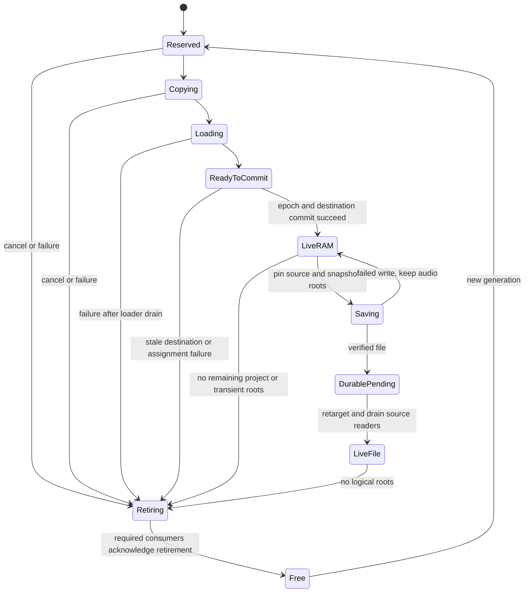

# Native Flex: ownership, reuse and memory redesign

2026-10-08 · **Status: proposed; research only** · Digitakt II OS 1.16

## Recommendation

Keep **immutable accepted takes**, preserve unsaved samples across pattern changes, and add a bounded ownership manager with explicit retirement. Do not turn the current workflow into destructive shared recorder slots by default. First establish the stock loader's source-read completion boundary; then reclaim the redundant CPU source after a verified durable handover. Reclaim unsaved takes only when all project and transient references have been removed and consumers have finished.

This is not a recommendation to call `free()` after USE or SAVE. Current lifetime assumptions extend into the loader, filename dialog and resource handlers. Those assumptions must be replaced together.

**EVIDENCE:** The current implementation intentionally retains successfully loaded sources until reboot. A new bounded CPU experiment additionally confirms retention when loading succeeds but final assignment fails. **UNRESOLVED:** no tested protocol currently proves when CPU source storage or stock playback storage may be reused under real scheduling.

Deliverable: this proposal and isolated source/diagnostic evidence, **not a firmware revision**. No firmware implementation, dependencies, Plaits, Capicola, project formats or hardware were changed. No builds, commits, publication or flashing were performed.

## Scope and evidence boundaries

User intent: make recording reusable and reliable without losing useful takes when changing patterns. Preserve twenty-second mono/stereo recording, ONESHOT assignment, explicit named save, automatic sample persistence on project save and existing Plaits/menu features. Resampling track/master should enter the same accepted-take lifetime after capture; physical source correctness is a separate gate.

The investigation can recommend architecture and experiments. It cannot choose destructive overwrite semantics for the user, promise whole-device free RAM, remove Plaits, or approve implementation. The applicable DSP research skill was used for proposal/evidence structure. Novel synthesis, musical-cultural borrowing, sonic authenticity, gain changes, tuning, and DSP algorithm porting are not applicable: audio representation and playback remain the stock PCM16 sampler path. No novelty claim is made. Retired SYS-001 procedures were not used.

Evidence terms used below:

- **EVIDENCE:** inspected source/manual or explicitly scoped experiment.
- **INFERENCE:** consequence of cited evidence, with assumptions stated.
- **HYPOTHESIS:** recommended mechanism that still needs a test.
- **UNRESOLVED:** a missing proof or measurement, not an implied capability.

### Live source identity

| Input | Inspected identity and scope |
|---|---|
| Research workspace | `main`, `096e6d21a080a651e84591826927bb095041f271`; clean at inspection. Active README, AGENTS and EMULATION read. |
| Machine lab | `codex/plaits-macro-controls`, `e66e3048cd9a9f0f16051f9ba0aac92e7400b7db`; inherited dirty README/STATUS/Plaits and untracked Capicola work preserved. Flex source hashes recorded separately. |
| Pinned DigiKit | `277760aad51b036a4756db051409d4d3b1eeccbc`, clean `.deps/digikit`; existing working DigiKit checkout inspected on `codex/dt2-sine-machine`, clean. No fetch/update there. |
| Existing Flex package | `out/runs/flex-20sec-menu-package-02`; previously verified MAIN `32081f9ce0db5002e271cdda883feecb54f72c0a1111cb1fa6782f690fe4743a`, SYX `5891f98485eb5eedf0707f6f302ea56ba3fd017547a25de89752a37611efc7e9`. These identify the prior artifact, not a newly tested hardware build. |
| This run | [Source manifest](../../../out/research/flex-redesign-2026-10-08/source-manifest.json), [observed lab status](../../../out/research/flex-redesign-2026-10-08/lab-status-observed.txt). `./labctl doctor` passed. |

Local links below point to the inspected files; the source manifest protects against future line/content drift. All Octakit links pin the revision, rather than a moving branch.

## What Octakit actually establishes

### Repository and license

The relevant repository is **[emuyia/ems-octakit](https://github.com/emuyia/ems-octakit)**, owned by the GitHub account `emuyia`. The [MIT license](https://github.com/emuyia/ems-octakit/blob/c6d3f3927b13fda0cf03711157237b837acdb1f9/LICENSE#L1-L36) names June Kiff, 2026, and excludes Elektron's firmware. Inspected revision: **`c6d3f3927b13fda0cf03711157237b837acdb1f9`**, commit date 2026-09-18, “add more feature descriptions”. A clean shallow clone is isolated under ignored `out/research/flex-redesign-2026-10-08/octakit`. No submodules or dependencies were installed; no private Octatrack firmware was supplied or built.

**EVIDENCE:** This is a native ColdFire **256 Kits per Project** mod for Octatrack OS **1.40C**, replacing bank-bound Parts. It is not DigiKit, an Octatrack emulator, or a replacement PCM recorder. The [README](https://github.com/emuyia/ems-octakit/blob/c6d3f3927b13fda0cf03711157237b837acdb1f9/README.md#L5-L25) describes reducing Flex capacity to accommodate Kit state and migrating existing Parts. This is useful evidence of an explicitly budgeted reservation, not a reusable recorder implementation.

### Source trace and applicable lessons

| Question | Inspected source evidence | What transfers / what does not |
|---|---|---|
| Memory reservation | [link.ld lines 1–27](https://github.com/emuyia/ems-octakit/blob/c6d3f3927b13fda0cf03711157237b837acdb1f9/runtime/link.ld#L1-L27) reserves `[0x45d0dde0,0x46025de0)`, 3,244,032 bytes; 128 descriptors, 128 spill entries, 115 two-byte lease sidecars. [firmware.json lines 5714–5724](https://github.com/emuyia/ems-octakit/blob/c6d3f3927b13fda0cf03711157237b837acdb1f9/runtime/firmware.json#L5714-L5724) patches a recorder-page allocation cap. | Reserve memory from an identified owner and reduce its allocation bounds. Do not borrow these addresses or assume the Digitakt heap is the same arena. |
| Layout guards | [link.ld lines 883–911](https://github.com/emuyia/ems-octakit/blob/c6d3f3927b13fda0cf03711157237b837acdb1f9/runtime/link.ld#L883-L911) asserts runtime, backup and staging bounds. | Explicit placement and overlap assertions are valuable. They are not runtime proof of all firmware writers. |
| Persistent roots | [allocator.S lines 4–73](https://github.com/emuyia/ems-octakit/blob/c6d3f3927b13fda0cf03711157237b837acdb1f9/runtime/allocator.S#L4-L73) retains/releases roots, checks range, corruption and counter overflow/underflow. | Owning references outlive the selected screen/track. These are Kit payload references. |
| Temporary readers | [runtime.S lines 268–351](https://github.com/emuyia/ems-octakit/blob/c6d3f3927b13fda0cf03711157237b837acdb1f9/runtime/runtime.S#L268-L351) acquires a selected descriptor, increments reader count before returning payload, and releases readers separately. | Separate logical roots from in-flight borrowers. A reference counter added only to our UI cannot account for stock loader or DSP readers. |
| Reclamation | [allocator.S lines 169–349](https://github.com/emuyia/ems-octakit/blob/c6d3f3927b13fda0cf03711157237b837acdb1f9/runtime/allocator.S#L169-L349) rejects busy roots/readers/copy states, checks sidecars and backing ownership, then clears descriptor/bitmap state. | Reuse requires multiple conditions, not “not selected”. No evidence here of PCM voice drain. |
| Copy/publication | [runtime.S lines 356–600](https://github.com/emuyia/ems-octakit/blob/c6d3f3927b13fda0cf03711157237b837acdb1f9/runtime/runtime.S#L356-L600) separates begin-copy, interruptible payload copying and finish-copy; pointer promotion waits for zero readers. | Prepare outside a short publication critical section. This is Part-state relocation, not replacing a sample under a DSP voice. |
| Pending voices | [voice_pending.S lines 74–109](https://github.com/emuyia/ems-octakit/blob/c6d3f3927b13fda0cf03711157237b837acdb1f9/runtime/voice_pending.S#L74-L109) hooks pending voice Part selection via sidecars. | Pending selection is a real owner distinct from current selection. The filename “voice” must not be mistaken for PCM buffer ownership. |
| Concurrency | Root/read/publication routines save SR, mask interrupts around state changes, then restore SR. [storage_gate.S](https://github.com/emuyia/ems-octakit/blob/c6d3f3927b13fda0cf03711157237b837acdb1f9/runtime/storage_gate.S#L12-L125) checks lifecycle, pending work and descriptors before publishing a persistence gate. | Explicit serialization and short state publication; do not transplant interrupt masking as a cross-CPU/DMA barrier. |
| Project transitions | [lifecycle.S lines 25–97](https://github.com/emuyia/ems-octakit/blob/c6d3f3927b13fda0cf03711157237b837acdb1f9/runtime/lifecycle.S#L25-L97) validates gates and lease sidecars; [project_lifecycle.S lines 281–306](https://github.com/emuyia/ems-octakit/blob/c6d3f3927b13fda0cf03711157237b837acdb1f9/runtime/project_lifecycle.S#L281-L306) quiesces/reset state before stock initialization. | Project change must be a coordinated lifecycle boundary, not an arbitrary list clear. |
| Persistence | [persistence.c lines 1–54](https://github.com/emuyia/ems-octakit/blob/c6d3f3927b13fda0cf03711157237b837acdb1f9/runtime/persistence.c#L1-L54) explicitly avoids heap allocation and reserves mutable I/O buffers. Its generation/CRC machinery is visible around lines 375–415 and 550–653. | Bounded staging and validation before publication; this stores Kits, not recorder audio. No claim of power-loss correctness was tested here. |
| Diagnostics/test scope | [exception_reporter.S](https://github.com/emuyia/ems-octakit/blob/c6d3f3927b13fda0cf03711157237b837acdb1f9/runtime/exception_reporter.S#L1-L9) prints crash context; [test_build.py](https://github.com/emuyia/ems-octakit/blob/c6d3f3927b13fda0cf03711157237b837acdb1f9/tests/test_build.py#L12-L59) checks patch guards and extraction with synthetic inputs. | No live recorder-memory meter or PCM reclamation test found in the inspected checkout. These tests do not prove its Kit ownership implementation on hardware. |

**UNRESOLVED:** Octakit does not establish the stock recorder PCM allocator's full lifecycle, overwrite synchronization, DSP sample references or on-device allocator counters. The source contains extracted-stock placeholders and hooks, not the full official implementation. No host emulator PCM behavior was substituted for missing firmware evidence.

### Official Octatrack behavior, separately

**EVIDENCE (manual):** Eight recorder buffers are assignable to Flex tracks; capture and playback are independent and a buffer can be shared. A new recording overwrites that buffer. Recorder contents do not automatically persist through power-off or project change. The Memory menu distinguishes occupied Flex RAM, free RAM and reserved recorder memory; dynamic recorders can consume free Flex memory. Changing reservations clears buffers after confirmation. See Elektron's [OS 1.40A manual, printed pages 38 and 44](https://www.elektron.se/wp-content/uploads/2024/09/Octatrack-MKII-User-Manual_ENG_OS1.40A_210414.pdf#page=38) (PDF indices 37 and 43). The manual is a different version from Octakit's 1.40C target.

**INFERENCE (product tradeoff):** Patterns referring to one mutable buffer hear its latest contents. Copying a pattern would not preserve an earlier recording. That differs from keeping distinct accepted takes. Pattern survival alone does not imply immutable audio; the user has not selected shared destructive semantics.

## Audit of current native Flex

### Ownership from capture to playback

| Object / phase | Actual current implementation | Lifetime and evidence |
|---|---|---|
| Original recorder data | Stock recorder service; Flex requests chunks while stopped. | `recording_copy()` [flex_native.py:100](../../../lab/flex_native.py#L100-L184) copies each response under the recorder lock; chunk limit 2,048 PCM bytes. No recorder storage allocation/reuse changes here. Whole-take immutability still relies on caller/stock scheduling, not a generation check. |
| Owned source | One stock-heap allocation: 64-byte node + 64-byte file header + PCM + 16-byte trailer. | [accept_recording:294–408](../../../lab/flex_native.py#L294-L408), allocator `0x4011e8f0`, free `0x4011e8fc`. Exactly `PCM + 144` requested bytes before allocator overhead. |
| Resource identity | A linked list, max 32. ID is `FIRST_ID + successful_count`; reference also includes content hash, file size and serial. | [constants:15–17](../../../lab/flex_native.py#L15-L17), [lookup:187–208](../../../lab/flex_native.py#L187-L208), [publication:358–405](../../../lab/flex_native.py#L358-L405). This is a lifetime allocation counter, not a count of currently used tracks. |
| Resource handles | Resolve/open validate all four reference words. Read uses handle ID and position; close returns success without a release count. | [handlers:211–291](../../../lab/flex_native.py#L211-L291). No source-reader leases or handle-generation check in read. Reusing IDs without redesign could redirect a stale open handle to a different take. |
| Stock loading | Source is published in the list, then `0x40154540` loads into an empty sample slot. | [accept:385–405](../../../lab/flex_native.py#L385-L405). Failure unlinks, clears prechecked destination through stock helpers and frees the new allocation. Success increments the counter before track assignment. |
| Playback storage | Stock loader sends independent pages and slot headers to SHARC. | Existing [probe:235–274](../../../scripts/probe-flex-native.py#L235-L274) verifies PCM transfer; DigiKit [sample-path findings:54–98](https://github.com/m-dwyer/digikit/blob/277760aad51b036a4756db051409d4d3b1eeccbc/docs/findings/15-sharc-sample-path.md#L54-L98) describes page copy and sample table. This supports distinct source/playback representations, not safe early release or physical completion. |
| Project sample pool | Assignment writes loaded reference to project pool and numeric slot to current ONESHOT track. | [assign:411–460](../../../lab/flex_native.py#L411-L460). Worker requires slot empty in project reference, loader key and loader length [worker:712–748](../../../lab/flex_native.py#L712-L748). It allocates a fresh slot, not a replacement of the previous take's slot. |
| Final UI assignment | Checks expected live-kit pointer, machine and slot, then refreshes stock track. | On failure, [finish:760–785](../../../lab/flex_native.py#L760-L785) forwards to error; no unlink/free/loader rollback. The worker's successful allocation remains. |
| Replacement / pattern change | Old node and old pool slot are not removed by accepting another take. | Conservative retention can preserve old patterns/locks; current Flex does not enumerate all pattern, undo, clipboard or pending-voice roots. Current track absence is not evidence of non-use. |
| Explicit save | Dialog borrows node and pool pointers; writer validates current pool pointer, writes file then promotes matching project-pool aliases. | [flex_native_save.py:1–5](../../../lab/flex_native_save.py#L1-L5), [manager:98–119](../../../lab/flex_native_save.py#L98-L119), [promote/writer:165–244](../../../lab/flex_native_save.py#L165-L244). Lifetime safety currently depends on nodes never being reclaimed. |
| Project save | First saves/caches every temporary pool reference; second pass substitutes durable refs; then original project writer runs. | [persist:558–632](../../../lab/flex_native.py#L558-L632), [guard:635–658](../../../lab/flex_native.py#L635-L658). A failed sample save blocks project writer. This is not a transaction across sample writes and the final project file. |
| Saved source | Durable-reference flag/cache is added to the node. CPU loader identity is not rewritten by pool promotion. | Source remains available for loader/explicit save; no free after success. Saving is not memory reclamation. The source may have become redundant, but proving that requires tracking outstanding consumers and future reloads. |
| Project teardown / reboot | Build emits one 56-byte state block and hooks USE, resource APIs, save and recorder keys. | [flex_native_build.py:48–151](../../../lab/flex_native_build.py#L48-L151), [hooks:239–257](../../../lab/flex_native_build.py#L239-L257). No project teardown reclaimer or epoch. Reboot ends the boot-lifetime allocations; unsaved audio is not durable. |

### Established faults, intentional retention and risks

| Priority | Finding | Confidence / consequence |
|---|---|---|
| High | Successful sources, including saved and replaced takes, retain CPU heap until reboot. | **EVIDENCE.** Bounded at 32 allocations, but not by an explicit byte budget or protected system headroom. It is intentional reachable retention, not proven allocator corruption or an unbounded pointer leak. |
| High | Load success followed by assignment failure retains node and count. | **EVIDENCE, emitted-code probe below.** Operational orphan/retention path; user sees failure but loses capacity. Safe cleanup still requires proving loader ownership. |
| High for redesign | Current resource read handles and save-dialog borrowed pointers are incompatible with naive free/reuse. | **EVIDENCE** of ID-only read and borrowed raw pointers; **INFERENCE** of stale-handle/use-after-free risk if reclamation is added in isolation. No current use-after-free claim. |
| High for redesign | Unselected tracks/patterns are not an ownership oracle. | **UNRESOLVED** complete root topology. Keep project-pool references pinned until a validated reachability/delete operation says otherwise. Include pending voices, sample locks, sound references and undo/clipboard. |
| Medium–high | Pointer equality is the current project-change guard, not a monotonically changing project identity. | **EVIDENCE** in worker, assign and named writer. **HYPOTHESIS:** same-address object reuse or changes during a long operation can defeat it; not reproduced. Add epochs and revalidate at commit. |
| Medium | Save's cached durable ref is trusted on subsequent project saves. | **EVIDENCE:** flag skips writer. **HYPOTHESIS:** external deletion/corruption could make the cache stale. Revalidate backing existence/identity before releasing the only source or committing a project. |
| Medium | Auto-save retries up to 64 names for any saver failure. | **EVIDENCE** [persist:595–608](../../../lab/flex_native.py#L595-L608). Distinguish collision from disk-full/I/O faults; otherwise failures can cause repeated synchronous work. No measured hardware latency. |
| Medium | Named save executes storage calls synchronously in dialog callback; no explicit manager-wide save/use/teardown gate. | **EVIDENCE** [callback:247–260](../../../lab/flex_native_save.py#L247-L260). Existing UI/scheduler may serialize some paths, but full concurrency and audible continuity remain unproved. |
| Medium | Current cleanup tests check list/counter/slot outcomes, not late stock readers, DMA completion or actual freed-byte recovery. | [probe:216–232](../../../scripts/probe-flex-native.py#L216-L232), [plusdrive_check:172–179](https://github.com/m-dwyer/digikit/blob/277760aad51b036a4756db051409d4d3b1eeccbc/tools/plusdrive_check.py#L172-L179). Mutex, event and FlexBus boundaries are modeled. |

### Research experiment completed

[retention_probe.py](../../../out/research/flex-redesign-2026-10-08/retention_probe.py) executes the **unchanged emitted ColdFire accept/finish instructions**. All stock services—including heap, copier, hash, loader and assignment—are explicitly mocked and listed in [retention-probe.json](../../../out/research/flex-redesign-2026-10-08/retention-probe.json).

Results: loader failure calls free and restores zero node/count; a successful load followed by failed assignment keeps the node/count; 32 modeled successful loads leave 32 allocations; the 33rd is rejected before services run. Uses minimum-length 141-frame mono takes, retaining 13,632 requested bytes. This isolates ownership flow; it does **not** simulate a complete repeated-recording session, prove stock allocator capacity, exercise real PCM reads, or validate hardware concurrency. The model leaves the test slot empty to isolate source ownership.

Reproduce from lab root:

```sh
'/Users/lanceship/Documents/Codex/Digitect firmware research project/work/digikit/.venv/bin/python' out/research/flex-redesign-2026-10-08/retention_probe.py
```

No broad regression suite or firmware build was justified by this documentation-only investigation.

## Memory arithmetic and distinct pools

At 48,000 frames/s, 20 seconds = 960,000 frames. PCM16 uses two bytes/channel/frame. [Exact arithmetic artifact](../../../out/research/flex-redesign-2026-10-08/memory-arithmetic.json).

| Quantity | Mono | Stereo |
|---|---:|---:|
| PCM payload | 1,920,000 B (1.8311 MiB) | 3,840,000 B (3.6621 MiB) |
| Current source file image, +80 B | 1,920,080 B | 3,840,080 B |
| Current source heap request, +144 B | 1,920,144 B | 3,840,144 B |
| 32 max-size source requests | 61,444,608 B (58.5981 MiB) | 122,884,608 B (117.1919 MiB) |
| Proposed 64-KiB source pages per max take | 30 (1,966,080 B) | 59 (3,866,624 B) |

These totals exclude allocator metadata/alignment, recorder storage, stock loader records/scratch, filesystem buffers and playback storage. They do not establish that all 32 maximum takes can fit the ColdFire heap.

**Peak overlap:** let `R` be existing recorder/preview memory, `S_old/S_new` owned sources and `L_old/L_new` stock playback allocations. Safe replacement must budget at least `R + S_old + S_new + L_old + L_new + work`, until old consumers are retired. If each playback representation contains one PCM payload, the four source/playback payloads plus two source headers/nodes are **15,360,288 B stereo** or **7,680,288 B mono**, before `R`, padding and work. This is an illustrative cross-pool total, not a claim that all reside in one heap. If source backing is replaced without reloading playback, `L_new` can be avoided only after proving that handover path. Aliases may share PCM; do not assume every slot adds another full copy.

**EVIDENCE:** DigiKit's [PCM comparator](https://github.com/m-dwyer/digikit/blob/277760aad51b036a4756db051409d4d3b1eeccbc/tools/plusdrive_check.py#L292-L315) compares transferred PCM16, deinterleaving stereo. This does not suggest an unconditional float32 doubling. Exact loader allocation padding and deduplication across old/new identities need measurement.

**Separate capacity domains:** current Capicola research identifies a **400 MiB logical sample pool**, provisionally reduced to **392 MiB** in its separate eight-MiB reservation experiment. It also executes stock sample free/total queries at `0x401537e0` / `0x4015381e` in prepared allocator states. See [capicola_memory.py:13–29](../../../lab/capicola_memory.py#L13-L29), [query tests:118–143](../../../scripts/check-capicola-owned.py#L118-L143), and [limitations](../capicola/CAPICOLA-OWNED-MEMORY-RESULTS.md). Those queries are **not ColdFire heap free space**, not all-device free RAM, and not evidence that eight MiB can be borrowed for Flex sources. Capicola work is untouched; future reservations must compose through one budget rather than claim the same region twice.

## Alternatives and design selection

| Approach | Advantages | Cost / failure mode | Decision |
|---|---|---|---|
| Fixed reusable recorder identities, Octatrack-style | Predictable bounded slot count; deliberate destructive loop workflow. | Re-recording changes every pattern sharing the slot; overwriting live PCM needs synchronization or double buffering. Eight stereo 20-second payloads alone cost 30,720,000 B before spare buffers. | Separate future mode only with explicit product approval. Not the default redesign. |
| Immutable accepted takes, bounded storage and reclamation | Preserves existing take identity and older patterns; can reclaim after root/reader retirement. | Must track project and transient roots; genuinely referenced unsaved audio still consumes memory. | **Recommended foundation.** |
| Durable file-backed handover after Save | Preserve identity while releasing redundant CPU source; existing user save choices fit. | Must drain old handles, retarget future opens and verify durability; disk errors and power failure need care. Saving alone does not release stock playback RAM. | **First practical reclamation milestone after tracing.** |
| Write every acceptance to a hidden file and discard RAM | Simplifies backing lifetime if storage reliable. | Changes no-intermediate-files behavior, incurs writes/latency and crash cleanup; not authorized by current workflow. | Do not silently introduce. |
| Keep increasing count/seconds | Small patch. | Retention grows; no lifetime solution. | Reject as redesign. |

Engineering analogies are principles, not a port: Linux [RCU documentation](https://www.kernel.org/doc/html/v6.2/RCU/whatisRCU.html) separates removing publication from waiting for readers and reclaiming memory. [SuperCollider Buffer](https://doc.sccode.org/Classes/Buffer.html#Completion%20Messages%20and%20Action%20Functions) separates client identity from server storage and exposes completion of asynchronous buffer work. [JACK callback guidance](https://jackaudio.org/api/group__ClientCallbacks.html) excludes blocking I/O, allocation and locks from real-time processing. These support explicit completion and deferred freeing; none supplies the Digitakt's missing completion event or memory-ordering guarantee. Do not import Linux RCU or a lock-free scheme merely for terminology.

## Recommended lifecycle and ownership contract

### Identity, roots and representation

Use a stable logical take identity `(project_epoch, object_index, generation)` separate from both the resource reference and stock playback slot. Keep at most 32 live descriptors initially; make that a **live capacity**, not a boot acceptance counter. Generation/epoch counters are monotonic, with fail-closed exhaustion instead of wrap/reuse. The precise encoding within stock-compatible resource references is an implementation proof obligation; do not serialize raw pointers or assume unused fields may be repurposed.

A descriptor records format/frames, source page chain, state, full resource ref, optional verified durable ref, all associated stock slots, root counts, open/read/transfer/save/dialog pins and last error. Content hash is a content check/deduplication input, not unique ownership identity. Hash collisions must not merge lifetimes.

| Storage / reference | Owner | Retain / release condition |
|---|---|---|
| Stock recorder take | Original recorder | Flex borrows only while capture is frozen at a checked capture generation. No attempt to free stock recorder memory. |
| Project pool reference | Project epoch / sample slot | Pin every matching pool entry initially, including inactive-pattern material. Remove only on a validated pool operation. |
| Pattern/locks/sounds/undo/clipboard | Project or transient subsystem | Until every reference path is traced, use conservative project pins; never collect based on the current 16 tracks alone. |
| Accepted source pages | Flex manager | Retain for unsaved project roots, open handles, ongoing copy/load/save and borrowed UI access; release only after all relevant conditions below hold. |
| Loader / DMA / resource handle | Loader job / transfer generation | Pin before publishing a pointer or handle; release on verified final consumption, including error/cancel paths. |
| Save dialog/job | Dialog instance / job token | Owned handle or pin on open, copy and release; no raw borrowed node after retirement becomes possible. |
| Playback PCM / active voice | Stock sample allocator and consumers | Flex does not free it directly. Use verified stock unload/replacement completion, including trailing/releasing/preview voices. |
| Durable file | Project/user storage | Verified backing for future reads; deletion is a separate user operation. Files do not count as RAM roots, but referenced file availability must be preserved. |
| Capicola analysis/readers, if integrated | Separate consumer lease | A future sample-derived bank/preparation job is another source consumer. Existing experimental generation checks are not automatically Flex pins. |

### State model



`LiveFile` can still have stock playback PCM and a small descriptor. Source-page retirement and playback-slot retirement are independent transitions. “File saved”, “source drained”, “voice stopped” and “project saved” are four different events.

### Publication and reclaim pseudocode

```text
accept(capture, destination):
    reserve descriptor + source pages + candidate playback capacity
    pin capture_generation; snapshot project_epoch and destination identity
    copy bounded chunks; validate capture remained frozen
    hash complete immutable source
    publish resource for loader with a job pin
    run stock load outside manager critical section
    wait for the established source/transfer completion condition
    on UI/manager commit: revalidate epoch, target, slot reservation, job token
    atomically publish pool reference + track selection
    drop job pin; old take remains rooted by its existing pool/other references
    on any failure: keep old assignment; retire candidate through verified cleanup

can_reclaim_source(t):
    no open/read/copy/transfer/save/dialog borrowers
    AND no future opener can obtain the RAM pointer
    AND (no remaining logical roots OR verified file-backed routing is active)
    AND the required completion fence has acknowledged this generation

can_reclaim_playback(t):
    no project/sample-lock/undo/pending-selection roots for that playback slot
    AND no playing/releasing/preview/derived consumer
    AND stock unload completes without leaving a pending transfer
```

No guessed “wait two blocks” or fixed sleep qualifies as a completion fence. If there is no observable safe condition, the state remains Retiring and admission can fail gracefully. Silent pin dropping to recover capacity is prohibited.

### Concurrency and identity constraints

One manager serializes metadata operations and project lifecycle. Jobs do copy/hash/storage/loader work outside its short critical section. On reentry they validate epoch, generation and job token. Lock ordering and stock callback reentrancy must be measured before specifying which firmware lock implements this; do not hold a manager lock across a stock call that can call back into the resource provider.

Use IRQ masking only for demonstrably short local publication if appropriate; it does not stop SHARC or a DMA engine. Existing recorder and filesystem lock requirements remain. No heap allocation, filesystem operation or waiting on the audio callback/ISR. Queue/pool exhaustion returns a visible error while preserving the previous assignment and completed take for retry.

A resource `open` must acquire identity safely and retain it until `close`; pending read/transfer pins may extend beyond close. Current handles only retain ID/position, so a generation-aware side table keyed by actual handle identity, or a proven compatible handle extension, is required. Keep tiny tombstone/forwarding descriptors if old stock keys must still resolve. Never recycle an ID just because a source block is freed. Pool-pointer equality must be replaced with epoch validation, including after long writes and in queued finish callbacks.

### Operation behavior

| Operation | Required behavior |
|---|---|
| Pattern change | No take reclamation merely because the pattern becomes inactive. Keep unsaved pool roots; ongoing voices retain old storage until done. |
| New accepted take | New immutable identity; preserve old pattern/slot references. Reuse memory only from retired objects. |
| User deletes/unloads an unused take | Remove validated roots, then defer playback/source release until all borrowers finish. If reference enumeration is incomplete, report pinned rather than delete. |
| Explicit save succeeds | Verify file, publish durable backing/aliases under epoch check, drain old RAM-source consumers. Keep stock playback alive; do not claim a project save. |
| Save fails / collision / disk full | No alias commit or source release. Preserve old file and source; distinguish collision from I/O failure. |
| Project save | Snapshot/pin all temporary pool roots, persist each once, commit references, then run project writer. If final writer fails, retain valid files and report project failure; do not delete data needed by a partially committed project. |
| Project change / reload | Block new jobs, drain/cancel jobs and dialogs, then enter a new epoch through stock teardown. Preserve existing save/discard choices; never silently discard on navigation. Saving the departing project persists its takes. Unsaved power-off survival is not promised. |
| Allocation failure | No publication; previous sample remains. Report which budget is exhausted. Candidate reservations are returned; in-flight source remains readable until cancellation completes. |
| Stop / Panic | Stop recording or voices through stock actions, but do not clear project ownership. A stopped sequencer does not prove every voice/preview stopped. |
| Reboot | Discard volatile descriptors only as part of boot. Load persisted project refs through the stock path. No promise to recover unsaved RAM. |

## Bounded budget and fragmentation proposal

**HYPOTHESIS, not a measured safe device setting:** start the ownership experiment with a **16 MiB CPU-source budget**, including 64 KiB of descriptor/page-map/queue accounting and 255 data pages of 64 KiB. Reserve 59 data pages for one maximum stereo candidate, leaving 196 pages for existing sources. This admits three maximum stereo takes (177 pages) or six maximum mono takes (180 pages) while preserving candidate headroom. Shorter takes fit more, up to the 32 live-descriptor limit. This is a deliberate provisional capacity reduction compared with the present optimistic 32-take ceiling, and must be reported to the user before product implementation.

The value is for falsifiable experiments, not permission to reserve unknown RAM. Enable a device budget only after measuring ColdFire heap bounds, worst-case non-Flex demand and a protected headroom margin; if 16 MiB cannot be reserved safely, reduce it and display the actual capacity or disable Flex cleanly. A 32 MiB option would require its own admission evidence. Do not subtract it from the 400 MiB playback pool without a separately verified mapping/ownership design.

Fixed-size pages allow returned storage to be reused without external fragmentation. Copy/read/save must become page-aware, so this is not a simple allocator swap: the current stock hash update and saver assume contiguous source storage. First prove streaming hash equivalence and fragmented read/save equivalence, or retain bounded contiguous allocations in the instrumentation phase. Unused tail space is <64 KiB per source. Reserve enough metadata and candidate pages up front; avoid allocating spare descriptors from an uncontrolled heap during acceptance. Do not compact live PCM under borrowers.

Two independent admission checks remain necessary: **Flex-owned source budget** and **stock playback allocation capacity**. Also bound descriptor counts, pending jobs, file handles and retire queue length. A full retire queue is pressure, not a reason to reuse still-pinned memory. Do not promise unlimited distinct unsaved takes in finite memory. Save/handover or explicit removal is how capacity returns.

## Visible diagnostics

Expose a small read-only Flex Memory view first, with independently defined counters:

- Flex-owned source bytes used / budget, candidate reserve and available pages.
- Live take descriptors, unsaved takes, durable takes, retiring takes and pin reasons.
- High-water mark; accepts/replacements; allocation, loader, assignment and save failures.
- Active loader/save jobs, source opens, outstanding transfers and stale-token rejections.
- Stock playback free/total **only after validating the stock query's semantics on the exact image**; label it Sample Pool, not system RAM.
- CPU heap free/largest block and whole-device pressure: display **unavailable** until allocator introspection is established. Host RSS and emulator allocations are not substitutes.

Use a bounded event ring, monotonically numbered job/epoch/generation records, saturating counters and coherent read snapshots. Logging must never allocate in a real-time path. Assert accounting equations such as `reserved_pages = free + live + candidate + retiring`, and `requested - released = owned_bytes`. An honest “source still pinned by loader” is more useful than a misleading free-memory percentage. Hardware deadline/dropout counters need their own instrumentation; absence of emulator faults is not a latency measurement.

## Smallest next proof and concrete validation plan

### First experiment: find the source-release boundary

**Working artifact sought:** a loader lifecycle trace plus a deterministic source-poison/read-watch result, at native/emulator structural and PCM-transfer evidence levels. This research run did not perform it.

1. Use a fresh isolated OS 1.16 snapshot and exact current Flex MAIN. Keep actual resource handlers and stock loader instructions. Instrument all resource opens/reads/closes, stock load entry/return, loader events, buffer-to-FlexBus submission and completion. Record CPU task/context, handle identity, source bounds, job and slot.
2. Use deterministic distinct A/B PCM, seed `0x464c4558`, 48 kHz PCM16. Conditions: mono/stereo × 141, 1025 and 960000 frames (six lengths/formats); same-length different-content negative pair; two-slot alias case. Preserve unmodified baseline traces.
3. Candidate release points are hypotheses: last resource read, close, stock-loader return and observed transfer completion. Watch/poison only the isolated candidate's CPU source at each point. Continue actual execution through re-trigger, preview, alias load, replacement, pattern return, explicit save and project reload. Do not start by freeing the real heap object; trapping the read is easier to diagnose.
4. Deliberately delay the final reader/transfer in the boundary model. A correct retirement barrier must wait. An intentionally early release must be detected by the harness; otherwise the test cannot validate the barrier. An immediate-copy host FlexBus model cannot prove DMA safety, so repeat with delayed consumption and eventually the physical implementation.
5. Require bit-exact captured PCM, zero post-retirement source reads and unchanged old references until commit. Bounded execution: at most 800 million CPU instructions per loader operation, use a fresh report and retain timeout as an inconclusive result. Do not convert instruction count into physical milliseconds.

Outputs: `loader-lifecycle.jsonl`, `source-read-watch.json`, `pcm-comparison.json`, exact image/source hashes and a summary of any modeled boundaries, under a fresh ignored `out/research/flex-lifetime-proof-*`. Keep failed traces. **Stop/pivot** if any delayed reader survives the proposed fence: retain source longer, add an explicit acknowledgment, or defer reclamation.

### Subsequent staged proof gates

| Stage | Work | Required cases and rejection comparator | Gate |
|---|---|---|---|
| 0: observability | Counters and ownership trace; no frees or changed user behavior. | Distinguish source and playback pools; compare stock/Plaits/Flex idle and load profiles. | Measurements explain each allocation/release; no unsupported free-memory claim. |
| 1: transactional failure cleanup | Candidate state, epoch/job validation and safe rollback after load/assignment failure. | Fail each allocation/copy/load/assign stage; project switch between worker and finish; delay unload acknowledgment. | Old audio/reference unchanged; all candidate reservations recovered after drain; no stale writes. |
| 2: save-backed source retirement | Stable descriptor + durable backing, dialog/open pins and future-open routing. | Name cancel/copy/destruction, collision, short write, close/rehash failure, deleted file, project writer failure, long-lived handle. | Source pages released only after verified file handover/drain; exact saved/reloaded PCM. |
| 3: unsaved reclamation and bounded pages | Conservative roots, page-aware resource/hash/save; explicit remove-unreferenced operation. | Pattern A take survives B/replacement/return; aliases; sample locks; sound refs; undo/clipboard; pending/releasing voices; fragmented pages. | Referenced takes never change; unreferenced takes release after consumer completion. Unknown roots remain pinned. |
| 4: repeated use | Recycling generations and source/playback capacity under stress. | 10,000 short accept/retire cycles; 100 max-length mixed mono/stereo cycles; >32 sequential jobs but ≤32 live; all-32-live refusal; stale ID/generation and near-wrap tests. | Owned bytes plateau after warmup; counts balance; full-budget refusal preserves takes; no ID alias or leaked jobs. |
| 5: live integration | Original scheduler, filesystem path and DSP transport, not only stubbed calls. | Input L/R/stereo, track/master resample, all machine guards, busy controls, delayed callbacks and project changes. | Actual sequencing and old/new voice behavior match ownership contract. |
| 6: physical gate | Separately authorized upload; exact package and backup/recovery retained. | Low/high stock sample usage, Plaits enabled, relevant Capicola variant if integrated, repeated 20-second records, saves during playback, disk-full errors, save/reload/reboot and 1–2 hour soak. | Audio continuity, responsiveness, measured memory plateau/headroom and durable PCM verified on device. Power-cut testing requires a separate sacrificial-data plan. |

The structural acceptance rule is exact state/PCM equality against baseline except for specified diagnostics, admission failures and memory reclamation. The musical workflow rule is that returning to an old pattern yields its original accepted take. Timing acceptance must be based on measured stock deadlines and physical audio capture; no invented timing guarantee is specified here. Listening checks target corruption, clicks, silence and interruptions, not a new sound-design quality claim.

## Remaining decisions and implementation boundary

The recommended product behavior is clear enough to proceed to a **lifetime-trace experiment**, if approved. A firmware redesign is not yet implementation-ready. Missing facts: source completion fence; full pattern/lock/undo/root graph; stock unload/voice retirement behavior; CPU heap arena/headroom; handle ABI for generation pins; persistence flush/power-loss semantics; cross-task serialization and cross-processor memory ordering.

The likely later files are `lab/flex_native.py`, `flex_native_build.py`, `flex_native_save.py`, focused tests and a new ownership module. No edit is proposed to Plaits DSP or Capicola in this work. A later approved implementation should freeze exact image hashes, shared reservation contracts, measured budget, reference encoding and test matrix before modifying emitted firmware. Octakit is reference material, not a new runtime dependency; no source port is proposed.

The next approval should cover the bounded loader-lifetime experiment only. Shared destructive buffers and a final memory-capacity setting remain separate user choices. Research stops here because that is the requested scope, not because implementation has been silently deferred or attempted.
